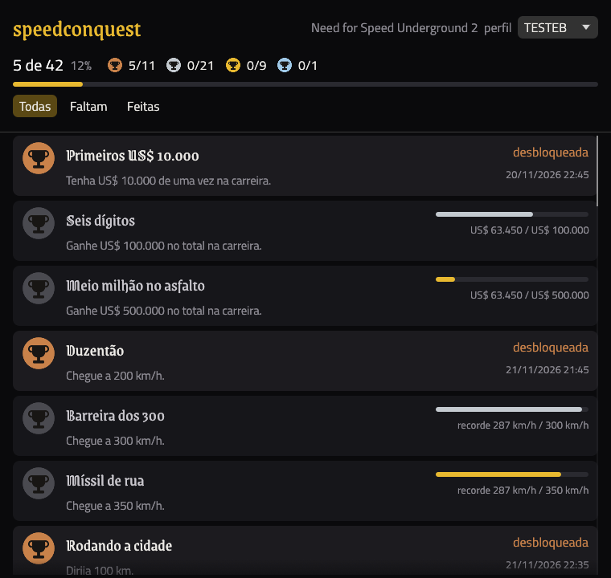
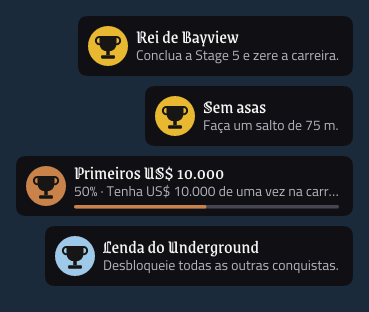

<div align="center">


# 🏆 speedconquest

**Conquistas offline estilo PS5 para o Need for Speed Underground 2 rodando no Wine, no Linux.**
Feito só para o NFSU2.

Sem conta, sem internet e sem mexer no jogo: um programa à parte lê a memória do jogo, percebe
quando você fez algo que merece um troféu e mostra um popup por cima da tela.




</div>

---

## ✨ O que ele faz

- **42 conquistas para o NFSU2**: carreira (etapas, patrocínio, capas, URL, especialista em cada
  tipo de corrida) e coisas absurdas (350 km/h, salto de 75 m, cambalhota de 1.080°, 5.000 km
  rodados, drag só com trocas perfeitas…). Bronze, prata, ouro e uma **platina** quando todas as
  outras saem. [Lista completa abaixo](#-conquistas-do-nfsu2).
- **Popup por cima do jogo**: barra fina com troféu na cor do nível, nome e descrição. Também
  avisa o **progresso** (25%, 50% e 75%) das conquistas de contagem.
- **Um conjunto de conquistas por save**: o progresso fica guardado pelo **nome do perfil** do
  jogo. Carregou o save X, valem as conquistas do X; outro perfil começa do zero.
- **Só vale o que você fizer a partir de agora**: as conquistas disparam por **evento** ("acabou
  de vencer", "acabou de passar de 300 km/h"), não por estado. Um save antigo com a carreira
  zerada não desbloqueia nada sozinho.
- **Estatísticas calculadas por ele**: odômetro, metros voados em saltos, voltas em cambalhotas,
  ganhos totais, vitórias por tipo. O jogo não guarda isso; o speedconquest calcula e guarda por
  perfil.
- **Janela com a lista** (`speedconquest janela`): perfil, total, contagem por nível, filtro
  Todas/Faltam/Feitas, data de cada desbloqueio e barra com "valor / meta" do que falta. Com o jogo
  aberto ela se atualiza sozinha a cada 2 s.

## 🔧 Como funciona

```
 SPEED2.EXE (Wine)            speedconquest (Linux, processo separado)
 ┌─────────────┐  /proc/pid/mem  ┌──────────┐   ┌───────────┐   ┌────────┐
 │ memória do  │ ──────────────▶ │ leitor   │──▶│ avaliador │──▶│ SQLite │
 │ jogo        │   30× por seg.  │ 30 Hz    │   │ eventos,  │   └────────┘
 └─────────────┘                 └──────────┘   │ derivadas │       ▲
        ▲                                       └─────┬─────┘       │ lê
        │ desenha por cima                            ▼             │
 ┌──────┴──────┐  janela X11 com              ┌──────────────┐  ┌───┴────┐
 │  gamescope  │◀─ GAMESCOPE_EXTERNAL_OVERLAY ─│ popup        │  │ janela │
 └─────────────┘                               └──────────────┘  └────────┘
```

1. **Detecta o jogo** pelo nome do processo (`SPEED2.EXE`) e confere o **sha256 do exe**. Outra
   versão do exe é recusada (os endereços seriam outros).
2. **Lê a memória** pelo `/proc/<pid>/mem`, 30 vezes por segundo. No Wine os endereços do Windows
   são os mesmos que o Linux vê. Nada é injetado no jogo (sem DLL, sem hook) e nada é escrito nele.
3. **Avalia**: cada conquista tem uma variável e uma meta (`jogos/nfsu2/conquistas.toml`). As
   variáveis vêm direto da memória (dinheiro, pontos de drift, tabela da carreira) ou são
   **derivadas** calculadas por ele (velocidade e odômetro pela posição, saltos pelas rodas e pela
   velocidade vertical, cambalhotas pelo vetor "pra cima" do carro, resultado de cada corrida pela
   tabela de resultados). Ao carregar um perfil, o primeiro segundo de leituras serve só de base.
4. **Grava** no SQLite e **mostra o popup**: um processo `speedconquest popup …` por vez, no mesmo
   display do jogo. No gamescope, a janela vai marcada como overlay externo e aparece por cima do
   jogo em tela cheia.

Os endereços e o método usado para achar cada um (scanmem, Ghidra) estão em
[`jogos/nfsu2/NOTAS.md`](jogos/nfsu2/NOTAS.md).

## 📊 Estado

**Versão 0.4**: as 42 conquistas, o popup e a janela funcionando e em uso.

| Parte | Estado |
|---|---|
| Leitura da memória, detecção do jogo e da versão | ✅ testado |
| Conquistas por perfil, troca de perfil sem disparo falso | ✅ testado |
| Popup por cima do jogo no gamescope (headless e na tela real) | ✅ testado |
| 42 conquistas do NFSU2 | ✅ cada tipo testado de ponta a ponta (escrevendo valores na memória do jogo pausado); a de 200 km/h já saiu jogando de verdade |
| Janela com a lista | ✅ testado (Xvfb e ao vivo com o vigia rodando) |
| Lançador `nfsu2` (gamescope + vigia juntos) | ✅ em uso |
| Popup **sem** gamescope (Wine direto em tela cheia) | ⚠️ não testado: sem garantia de ficar por cima do jogo |
| Corrida da **carreira** ao vivo (Passeio no parque, Mão de relojoeiro) | ⚠️ testado só no Quick Race, que grava a mesma tabela |
| Janela com escala de DPI diferente de 1 | ⚠️ não testado |
| Som no popup | ❌ ainda não tem |
| Windows nativo | ❌ não funciona ([por quê](#-e-no-windows)) |

**Limitações conhecidas** (aceitas):
- Assistir a um **replay** soma no odômetro, nas cambalhotas e nos saltos (não achei a flag de replay).
- Virar de teto e voltar pelo mesmo lado conta como uma cambalhota de 360°.
- Com o lançador em supersampling 2× (`nfsu2 --ss 2`, 2732×1536) o SPEED2.EXE fecha com page fault ao
  abrir. O padrão é 1×.
- O `cargo audit` avisa que o `ttf-parser` (usado pelo `ab_glyph`) está sem manutenção. Não tem falha
  conhecida, só o aviso.

## 🎮 Versão do jogo suportada

| Jogo | Exe | sha256 |
|---|---|---|
| Need for Speed Underground 2 (PC) | `SPEED2.EXE` (32 bits) | `f9dd86c054878ce6276beb07c1fd61874f7a1e4bf1f241b084c65b73e24168a7` |

Confira o seu com `sha256sum SPEED2.EXE`. Testado com o WidescreenFix (ASI do dinput8) e o NFSU2
Unlimiter instalados; eles não mexem nos endereços usados. Outro exe é recusado com uma mensagem no
log mostrando o sha256 dele. Para suportar outra versão é preciso achar os endereços dela e
acrescentar o sha256 no `jogo.toml`.

## 📦 Requisitos

**Para rodar**
- Linux x86_64 com **X11** (a janela e o popup usam X11; no Wayland, só dentro do gamescope ou do
  XWayland).
- **Wine** com o NFSU2 instalado. Testado no WineHQ staging 11.22, prefixo win64 em `~/.wine`, com
  DXVK.
- **gamescope** para o popup aparecer por cima do jogo em tela cheia. Testado na versão 3.17, com
  `--backend sdl`.
- **Permissão para ler a memória de outro processo**: `kernel.yama.ptrace_scope` igual a **0**.
  Confira com `cat /proc/sys/kernel/yama/ptrace_scope`. Algumas distros, como o Ubuntu, vêm
  com 1. Para mudar até o próximo boot: `sudo sysctl kernel.yama.ptrace_scope=0`. Não precisa de
  root para rodar o speedconquest.
- Bibliotecas que todo desktop já tem (a janela carrega na hora de abrir): libGL/libEGL (Mesa),
  libX11, libxcb, libXcursor, libXrandr, libXi e libxkbcommon(-x11).

**Para compilar**
- Rust **1.95** ou mais novo (edição 2024; testado no 1.100).
- Um compilador C (`build-essential`): o SQLite vem junto e é compilado pelo `rusqlite`.

**Crates principais**: `eframe`/`egui` 0.37 (janela, com glow e x11, sem wgpu) · `rusqlite`
(SQLite embutido) · `x11rb` (janela do popup) · `tiny-skia` + `ab_glyph` (desenho do popup) ·
`serde` + `toml` (configuração dos jogos) · `sha2` (versão do exe) · `anyhow`.

**Ferramentas opcionais** (só para descobrir endereços novos): `scanmem`, Ghidra e Python 3.11+
(scripts em `ferramentas/`).

## 🚀 Instalação

```bash
git clone https://github.com/1155dosilicon/speedconquest
cd speedconquest
cargo build --release
install -m755 target/release/speedconquest ~/.local/bin/

# Opcional: lançador do NFSU2 (abre o jogo no gamescope e sobe o speedconquest junto)
install -m755 extras/nfsu2 ~/.local/bin/
# Opcional: atalho no menu (Jogos → speedconquest) com ícone
cp extras/speedconquest.desktop ~/.local/share/applications/
install -Dm644 extras/speedconquest.svg ~/.local/share/icons/hicolor/scalable/apps/speedconquest.svg
```

Se o menu não achar o programa (o `~/.local/bin` fora do PATH da sessão), troque o `Exec=` do
`.desktop` pelo caminho completo.

O lançador `nfsu2` aceita `WINEPREFIX` (padrão `~/.wine`) e `NFSU2_DIR` (pasta do jogo; o padrão é a
pasta da instalação da EA dentro do prefixo). Ele grava a resolução da tela no registro do jogo antes
de abrir.

## 🕹️ Uso

| Comando | O que faz |
|---|---|
| `nfsu2` | Abre o jogo no gamescope com o vigia junto. `--simples` abre sem gamescope; `--ss N` com supersampling |
| `speedconquest` | **Vigia**: espera o jogo abrir, anexa e avalia as conquistas. Fica rodando; o log vai para o stderr |
| `speedconquest janela` | Janela com a lista de conquistas |
| `speedconquest lista` | A mesma lista no terminal |
| `speedconquest relatorio` | Resumo das estatísticas e do histórico de dinheiro (se ligado) |
| `speedconquest popup NIVEL TÍTULO TEXTO [PCT]` | Mostra um popup de teste (`NIVEL` = bronze, prata, ouro ou platina) |
| `speedconquest png SAIDA.png` | Desenha o popup de todas as conquistas em PNGs (sem precisar de X) |

Sem o lançador, rode `speedconquest &` antes de abrir o jogo. Para o popup aparecer por cima, rode o
jogo dentro do gamescope:

```bash
cd ~/".wine/drive_c/Program Files (x86)/EA GAMES/Need for Speed Underground 2"
gamescope --backend sdl -f -W 1920 -H 1080 -- wine SPEED2.EXE
```

**Variáveis de ambiente**

| Variável | Para quê |
|---|---|
| `SPEEDCONQUEST_DB` | Usa outro banco (testes sem tocar no progresso de verdade) |
| `SPEEDCONQUEST_DEBUG=1` | Mostra no log os valores lidos uma vez por segundo e cada resultado de corrida |
| `SPEEDCONQUEST_FONTE_TITULO`, `SPEEDCONQUEST_FONTE_TEXTO` | Testa outra fonte `.ttf` no popup |
| `SPEEDCONQUEST_GRAVACAO` | CSV de posições para o teste de calibração dos saltos (`cargo nextest run --run-ignored only`) |

**Onde ficam os dados**: `~/.local/share/speedconquest/conquistas.db` (ou `$XDG_DATA_HOME/...`).

| Tabela | Conteúdo |
|---|---|
| `desbloqueio` | (jogo, perfil, conquista, quando) |
| `marco` | Avisos de 25/50/75% já mostrados |
| `estatistica` | Derivadas guardadas por perfil: odômetro, ganhos, voltas, metros no ar, corridas |
| `maior` | Maior valor já visto de cada variável de progresso (o que a janela mostra) |
| `historico` | Mudanças das variáveis com `registrar = true` (desligado no NFSU2) |

## 🏁 Conquistas do NFSU2

**42 conquistas:** 🥉 bronze 11 · 🥈 prata 21 · 🥇 ouro 9 · 🏆 platina 1

| | Nome | Como desbloquear | Avisos 25/50/75% |
|---|---|---|---|
| 🥉 | **Primeiros US$ 10.000** | Tenha US$ 10.000 de uma vez na carreira. | sim |
| 🥈 | **Seis dígitos** | Ganhe US$ 100.000 no total na carreira. | sim |
| 🥇 | **Meio milhão no asfalto** | Ganhe US$ 500.000 no total na carreira. | sim |
| 🥉 | **Duzentão** | Chegue a 200 km/h. | — |
| 🥈 | **Barreira dos 300** | Chegue a 300 km/h. | — |
| 🥇 | **Míssil de rua** | Chegue a 350 km/h. | — |
| 🥉 | **Rodando a cidade** | Dirija 100 km. | sim |
| 🥈 | **Mil quilômetros** | Dirija 1.000 km. | sim |
| 🥇 | **Estrada sem fim** | Dirija 5.000 km. | sim |
| 🥉 | **De lado** | Faça 100 mil pontos num evento de drift. | — |
| 🥈 | **Drift sem fim** | Faça um único drift de 25 mil pontos. | — |
| 🥇 | **Rei do drift** | Faça 500 mil pontos num evento de drift. | — |
| 🥉 | **Capotou!** | Dê uma cambalhota completa (360°). | — |
| 🥈 | **Cambalhota dupla** | Gire 720° numa cambalhota só. | — |
| 🥇 | **Circo de Bayview** | Gire 1.080° (3 voltas) numa cambalhota só. | — |
| 🥈 | **Dublê** | Dê 25 voltas completas em cambalhotas. | sim |
| 🥈 | **Pé embaixo** | Fique 30 s seguidos acima de 250 km/h. | — |
| 🥉 | **Decolagem** | Faça um salto de 30 m. | — |
| 🥈 | **Voo rasante** | Faça um salto de 50 m. | — |
| 🥇 | **Sem asas** | Faça um salto de 75 m. | — |
| 🥈 | **Milhas aéreas** | Voe 1 km somando todos os saltos. | sim |
| 🥉 | **Chegou na cidade** | Conclua o prólogo. | — |
| 🥉 | **Etapa 1** | Conclua a Stage 1 da carreira. | — |
| 🥉 | **Etapa 2** | Conclua a Stage 2 da carreira. | — |
| 🥈 | **Etapa 3** | Conclua a Stage 3 da carreira. | — |
| 🥈 | **Etapa 4** | Conclua a Stage 4 da carreira. | — |
| 🥇 | **Rei de Bayview** | Conclua a Stage 5 e zere a carreira. | — |
| 🥉 | **Patrocinado** | Assine o primeiro contrato de patrocínio. | — |
| 🥉 | **Capa de revista** | Saia na capa de uma revista. | — |
| 🥈 | **Capa de DVD** | Saia na capa de um DVD. | — |
| 🥇 | **Garoto-propaganda** | Conquiste as 30 capas de revista e DVD. | sim |
| 🥈 | **Liga URL** | Vença os 24 eventos URL. | sim |
| 🥈 | **Fujão** | Vença 50 outruns na carreira. | sim |
| 🥈 | **Especialista em circuito** | Vença todas as 56 corridas de circuito da carreira. | sim |
| 🥈 | **Especialista em sprint** | Vença todas as 36 corridas de sprint da carreira. | sim |
| 🥈 | **Especialista em Street X** | Vença todas as 36 corridas de Street X da carreira. | sim |
| 🥈 | **Especialista em drag** | Vença todas as 34 corridas de drag da carreira. | sim |
| 🥈 | **Especialista em drift** | Vença todas as 36 corridas de drift da carreira. | sim |
| 🥇 | **Invicto** | Vença as 222 corridas da carreira. | sim |
| 🥈 | **Passeio no parque** | Vença um circuito 30 s à frente do 2º. | — |
| 🥈 | **Mão de relojoeiro** | Vença um drag só com trocas perfeitas. | — |
| 🏆 | **Lenda do Underground** | Desbloqueie todas as outras conquistas. | — |

As metas de dinheiro foram calibradas pela tabela de prêmios da carreira: as 224 corridas pagam
US$ 547.950 no total (`ferramentas/nfsu2_carreira.py`). As de velocidade, drift, salto e cambalhota
são **recordes** num momento só, por isso não têm avisos de progresso; a janela mostra o seu
recorde. Tabela gerada com `python3 ferramentas/conquistas_md.py jogos/nfsu2/conquistas.toml`.

## 🗂️ Estrutura

```
src/
  main.rs       comandos, vigia (30 Hz), fila de popups, platina
  processo.rs   acha o processo, base dos módulos (/proc/pid/maps), sha256, leitura e ponteiros
  config.rs     jogo.toml + conquistas.toml + listas.toml (embutidos no binário)
  avaliador.rs  transições, marcos, derivadas (odômetro, velocidade, saltos, giro, corridas…)
  banco.rs      SQLite
  popup.rs      popup (tiny-skia + ab_glyph, janela X11 / overlay do gamescope)
  janela.rs     janela egui
jogos/nfsu2/
  jogo.toml       exe aceito, variáveis (módulo+deslocamento+cadeia de ponteiros), derivadas, unidades
  conquistas.toml a lista de conquistas
  listas.toml     hashes das corridas da carreira por tipo
  NOTAS.md        endereços, estruturas e como cada coisa foi achada e testada
ferramentas/    varredura de memória, extração da tabela da carreira, gerador desta tabela
ghidra/scripts/ scripts do Ghidra usados na análise
extras/         lançador nfsu2, .desktop e ícone
assets/fontes/  Grenze Gotisch e Titillium Web (SIL OFL 1.1)
PLANO.md        diário de desenvolvimento: decisões, roteiro e estado de cada versão
AGENTS.md       guia para agentes de IA (CLAUDE.md importa ele; llms.txt resume o projeto)
```

**Acrescentar uma conquista** a um jogo que já existe: um bloco `[[conquista]]` no `conquistas.toml`
com `id`, `nivel`, `nome`, `descricao` e `progresso = { var = "...", meta = N }` (e `marcos = false`
para recordes), apontando para uma variável ou derivada do `jogo.toml`. Os arquivos vão embutidos,
então é preciso recompilar.

## 🪟 E no Windows?

Hoje **não funciona**. As regras, o banco e a janela rodariam igual, e os endereços do NFSU2 são os
mesmos. Três partes são de Linux:
1. a leitura da memória (`/proc`), que teria de virar `OpenProcess`/`ReadProcessMemory`;
2. o popup (X11 + overlay do gamescope), que teria de virar uma janela transparente sempre por cima.
   O problema é a **tela cheia exclusiva** do Direct3D 9, que fica por cima de janelas comuns: seria
   preciso jogar em janela sem borda ou desenhar dentro do Direct3D (injetar código, o que o projeto
   evita);
3. o lançador (bash/gamescope).

## 🧪 Testes

```bash
cargo nextest run     # ou cargo test
cargo clippy --all-targets
```

Os testes de unidade cobrem o avaliador (transições, marcos, cada derivada), o banco e a
configuração embutida. Os testes de ponta a ponta foram feitos com o jogo rodando num gamescope sem
tela, com um banco de teste (`SPEEDCONQUEST_DB`) e um perfil de teste, escrevendo valores na memória
do jogo. As receitas estão em `jogos/nfsu2/NOTAS.md`.

## 📜 Licença

Código sob a [licença MIT](LICENSE). As fontes em `assets/fontes/` são da SIL Open Font License 1.1
(licenças ao lado de cada uma). O ícone e o troféu do popup foram desenhados para o projeto.

Nenhum arquivo do jogo está incluído. *Need for Speed* e *Need for Speed Underground 2* são marcas da
Electronic Arts; este projeto não tem ligação com a EA. Ele não altera o jogo, não funciona online e
não ajuda a trapacear.
